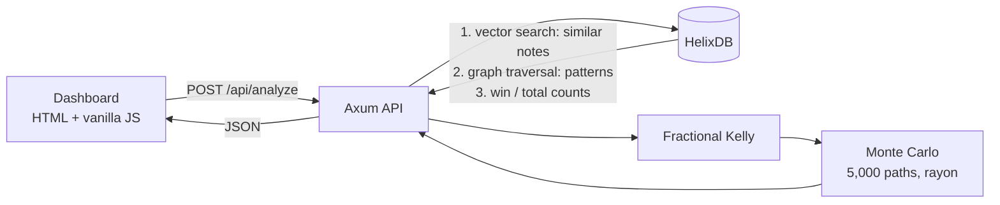

# AutoRiskolution AI

A context-aware position-sizing co-pilot. A trader enters a trade setup and a free-text
note about the market; the backend finds similar past trades, turns their history into a
win rate, and returns a Kelly-sized position plus an account-survival percentage.

**Stack:** Rust · Tokio + Axum · HelixDB (`helix-db` 3.0.0) · Ripwire (MCP) · plain HTML + Tailwind CDN + vanilla JS.
No Python, no Node, no build step for the frontend.

## How it works



1. **Hybrid query (one HelixDB transaction).** Vector-search the 5 past trades whose notes
   are closest to the new note, walk `TradeLog -[HAS_PATTERN]-> Pattern`, then walk back to
   every trade tagged with those patterns and count total and winning trades.
2. **Win rate.** Laplace-smoothed `(wins + 1) / (total + 2)` so tiny samples are not trusted.
   If even the closest note is too distant (cosine distance > 0.35), the app reports
   "no historical evidence" and sizes at a cautious 1%.
3. **Sizing.** Kelly `f = p - (1 - p) / b`, quarter-Kelly, capped at 5% of balance per trade.
   No edge means a size of zero.
4. **Survival.** 5,000 seeded random 100-trade futures, run in parallel. Survival is the share
   that never lose more than 50% of the account. The dashboard compares the recommended size
   with the size the trader intended.

## Run it

Prerequisites: Rust 1.88+, Docker, and the Helix CLI (`curl -sSL "https://install.helix-db.com" | bash`).

```bash
helix start dev        # HelixDB on :6969 (in-memory)
cargo run              # indexes + seeds demo history, serves on :8080
```

Open http://localhost:8080 and try the two example buttons.

```bash
curl -s -X POST http://127.0.0.1:8080/api/analyze -H 'content-type: application/json' \
  -d '{"balance":10000,"entry":100,"target":110,"stop_loss":95,
       "note":"Market feels nervous and volatile before inflation news","intended_risk_pct":10}'
```

```bash
cargo test                                   # 20 unit tests
cargo test -- --ignored --nocapture          # 3 live tests (need helix start dev)
```

## Layout

```
src/main.rs                 entry point: connect, seed, serve
src/api.rs                  Axum routes, validation, sizing logic
src/risk/kelly.rs           Kelly maths
src/risk/monte_carlo.rs     parallel simulation
src/database/queries.rs     HelixDB queries (typed Rust DSL)
src/database/embedding.rs   text -> vector (see limitations)
src/database/context.rs     hybrid-query response -> typed context
src/database/seed.rs        demo trade history
public/index.html           dashboard
.mcp/ripwire-server.json    Ripwire MCP server config
```

## Ripwire (MCP)

`.mcp/ripwire-server.json` registers `ripwire --mcp` as a local stdio MCP server, so an AI
agent can map this repo without reading every file. On this repo, Ripwire's ranked map is
5,639 bytes against 57,105 bytes of source (about 90% fewer bytes; bytes are only a rough
proxy for tokens). Register with Claude Code via `claude mcp add ripwire -- ripwire --mcp`.

## Limitations (deliberate, and worth knowing)

- **The embedder is a stand-in.** `embed()` is a hashed bag-of-words with a small trading
  lexicon. It matches wording and a few synonym groups, not meaning. It sits behind one
  function so a real embedding model can replace it.
- **HelixDB runs in memory.** Data is lost on restart, so the demo history is re-seeded on
  start. Use `helix start dev --disk` to persist.
- **The seed data is synthetic** (24 invented trades in 3 patterns), only for demonstration.
- **Model assumptions.** Kelly and the simulation assume independent trades, a fixed win
  rate and a constant risk fraction. Real markets break these. The simulation's median and
  upside figures are deliberately not shown because compounding makes them misleading.
- **Not financial advice.** This is decision support and a portfolio demonstration.